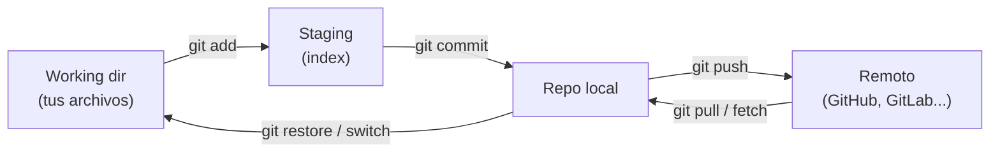

# Guía de trabajo con Git: de básico a intermedio

## Índice
1. [Conceptos básicos](#1-conceptos-básicos)
2. [Configuración inicial](#2-configuración-inicial)
3. [Flujo básico](#3-flujo-básico)
4. [Historial y diferencias](#4-historial-y-diferencias)
5. [Deshacer cambios](#5-deshacer-cambios)
6. [Ramas (branches)](#6-ramas-branches)
7. [Repositorios remotos](#7-repositorios-remotos)
8. [Merge y resolución de conflictos](#8-merge-y-resolución-de-conflictos)
9. [Rebase](#9-rebase)
10. [Stash](#10-stash)
11. [Tags](#11-tags)
12. [.gitignore](#12-gitignore)
13. [Flujo de trabajo recomendado](#13-flujo-de-trabajo-recomendado)
14. [Buenas prácticas](#14-buenas-prácticas)
15. [Chuleta rápida](#15-chuleta-rápida)

---

## 1. Conceptos básicos

| Término | Significado |
|---|---|
| **Repositorio** | Carpeta con el proyecto y su historial (`.git`) |
| **Working directory** | Tus archivos tal como los ves |
| **Staging area (index)** | Zona donde preparas lo que irá en el próximo commit |
| **Commit** | Foto (snapshot) del proyecto en un momento dado |
| **Branch** | Línea independiente de desarrollo |
| **HEAD** | Puntero a tu commit/rama actual |
| **Remote** | Copia del repo en otro sitio (GitHub, GitLab...) |



```
 Working dir ──git add──▶ Staging ──git commit──▶ Repo local ──git push──▶ Remoto
      ▲                                                │  ▲                  │
      └───────────── git restore / switch ─────────────┘  └──── git pull ────┘
```

## 2. Configuración inicial

```bash
git config --global user.name "Tu Nombre"
git config --global user.email "tu@email.com"
git config --global init.defaultBranch main
git config --global core.editor "nano"
git config --list
```

## 3. Flujo básico

```bash
git init                    # crear repo nuevo
git clone <url>             # clonar uno existente
git status                  # estado de los archivos
git add archivo.txt         # añadir un archivo al staging
git add .                   # añadir todo
git commit -m "Mensaje"     # crear commit
git commit -am "Mensaje"    # add + commit (solo archivos ya rastreados)
```

## 4. Historial y diferencias

```bash
git log                         # historial completo
git log --oneline --graph --all # resumido con gráfico de ramas
git log -p archivo.txt          # cambios de un archivo
git diff                        # cambios sin añadir al staging
git diff --staged               # cambios en staging
git show <commit>               # detalle de un commit
git blame archivo.txt           # quién modificó cada línea
```

## 5. Deshacer cambios

```bash
git restore archivo.txt            # descartar cambios del working dir
git restore --staged archivo.txt   # sacar del staging
git commit --amend -m "Nuevo msg"  # modificar el último commit
git revert <commit>                # crea un commit que deshace otro (seguro)
git reset --soft HEAD~1            # deshace commit, mantiene cambios en staging
git reset --mixed HEAD~1           # deshace commit, cambios en working dir
git reset --hard HEAD~1            # deshace commit y BORRA cambios (¡peligroso!)
git reflog                         # historial de movimientos de HEAD (rescate)
```

> ⚠️ No uses `reset --hard` ni `--amend` sobre commits ya publicados (pusheados) en ramas compartidas. Usa `revert`.

## 6. Ramas (branches)

```bash
git branch                  # listar ramas
git branch nueva            # crear rama
git switch nueva            # cambiar de rama
git switch -c nueva         # crear y cambiar
git branch -m nuevo-nombre  # renombrar rama actual
git branch -d nueva         # borrar rama (fusionada)
git branch -D nueva         # borrar rama a la fuerza
```

## 7. Repositorios remotos

```bash
git remote -v                          # ver remotos
git remote add origin <url>            # añadir remoto
git push -u origin main                # primer push (enlaza la rama)
git push                               # subir cambios
git fetch                              # descargar sin fusionar
git pull                               # fetch + merge
git pull --rebase                      # fetch + rebase
git push origin --delete nombre-rama   # borrar rama remota
```

## 8. Merge y resolución de conflictos

```bash
git switch main
git merge feature     # fusiona 'feature' en 'main'
```

Si hay conflicto, Git marca el archivo:

```
<<<<<<< HEAD
tu versión
=======
la versión entrante
>>>>>>> feature
```

Pasos:
1. Edita el archivo y deja el contenido final (elimina los marcadores).
2. `git add archivo`
3. `git commit` (o `git merge --continue`)

Para cancelar: `git merge --abort`.

## 9. Rebase

Reaplica tus commits encima de otra base, generando un historial lineal.

```bash
git switch feature
git rebase main
# si hay conflictos: resolver -> git add -> git rebase --continue
git rebase --abort            # cancelar
git rebase -i HEAD~3          # interactivo: reordenar, unir (squash), editar commits
```

> ⚠️ Regla de oro: **nunca hagas rebase de ramas ya compartidas**.

**Merge vs Rebase**: merge conserva el historial real con un commit de fusión; rebase lo deja lineal pero reescribe commits.

## 10. Stash

Guarda cambios temporalmente sin hacer commit.

```bash
git stash                  # guardar
git stash -u               # incluir archivos sin rastrear
git stash list             # listar
git stash pop              # recuperar y eliminar del stash
git stash apply            # recuperar y mantener
git stash drop             # borrar el último
```

## 11. Tags

```bash
git tag v1.0.0                     # tag ligero
git tag -a v1.0.0 -m "Versión 1"   # tag anotado
git tag                            # listar
git push origin v1.0.0             # subir un tag
git push --tags                    # subir todos
```

## 12. .gitignore

Archivo en la raíz que indica qué no rastrear:

```gitignore
node_modules/
*.log
.env
dist/
.DS_Store
```

Si ya estaba rastreado: `git rm --cached archivo`.

## 13. Flujo de trabajo recomendado

```bash
git switch main && git pull           # 1. actualizar main
git switch -c feature/mi-cambio       # 2. crear rama
# ... trabajar ...
git add . && git commit -m "feat: descripción"   # 3. commits pequeños
git push -u origin feature/mi-cambio  # 4. subir rama
# 5. abrir Pull Request, revisión y merge
git switch main && git pull           # 6. actualizar
git branch -d feature/mi-cambio       # 7. limpiar
```

## 14. Buenas prácticas

- Commits pequeños y atómicos, con mensajes claros.
- Convención de mensajes: `feat:`, `fix:`, `docs:`, `refactor:`, `test:`, `chore:`.
- Haz `git pull` antes de empezar a trabajar.
- Una rama por funcionalidad o corrección.
- Nunca subas contraseñas, claves ni `.env`.
- Revisa `git status` y `git diff --staged` antes de commitear.

## 15. Chuleta rápida

| Quiero... | Comando |
|---|---|
| Ver estado | `git status` |
| Guardar cambios | `git add . && git commit -m "msg"` |
| Ver historial bonito | `git log --oneline --graph --all` |
| Deshacer último commit (conservando cambios) | `git reset --soft HEAD~1` |
| Descartar cambios de un archivo | `git restore archivo` |
| Crear y cambiar de rama | `git switch -c rama` |
| Guardar trabajo temporal | `git stash` / `git stash pop` |
| Recuperar algo perdido | `git reflog` |

## Ejercicios prácticos

1. Crea un repo, añade 3 archivos y haz 3 commits distintos.
2. Crea una rama `feature`, haz cambios y fusiónala en `main`.
3. Provoca un conflicto editando la misma línea en dos ramas y resuélvelo.
4. Usa `git stash` para cambiar de rama con trabajo a medias.
5. Haz un `rebase -i` para unir dos commits en uno.
6. Recupera un commit "perdido" con `git reflog`.
